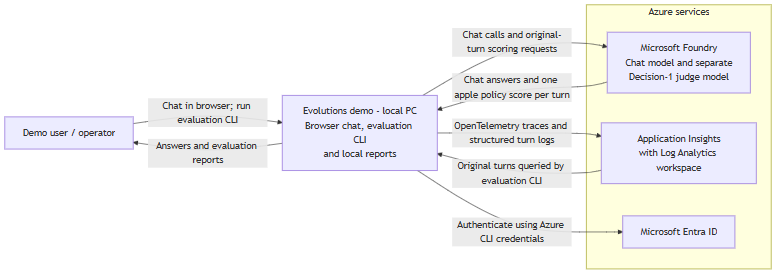

# Evolutions demo

## Executive summary

**AI evaluations (evals) systematically assess AI outputs against explicit criteria.**
A successful API call does not mean the answer is useful, follows instructions or
stays within the intended scope. Evals complement software tests by checking those
qualities using automated rules, human reviewers or another AI model acting as a judge.

**Evals turn individual impressions into comparable evidence.** They help teams
identify failure patterns, compare prompt or model changes and detect regressions
before release. Meaningful comparisons need consistent datasets and criteria;
model-based judgments can vary and should be calibrated against human assessments.

**This apple demo makes that workflow concrete.** An English-language FastAPI chat
runs locally, uses an Azure Foundry model, and is instructed to answer apple-related
questions while refusing unrelated topics. OpenTelemetry records the original
questions, answers and conversation context in Azure. A separate, noninteractive CLI
retrieves those original turns and scores them with Microsoft-Decision-1 through its
native Foundry decision API. One request per turn assesses one clear metric:
apple scope compliance. Results appear
in the console and detailed local report files; no replacement answers are generated.

This is a reference demo for developers, not a calibrated production quality gate.

**Guide:** [Set up](#1-set-up-once) -> [Start the chat](#2-start-the-chat) ->
[Run evaluation](#3-evaluate-original-responses) -> [Read the results](#4-read-the-results).
**Architecture:** [System context](#system-context) | [Telemetry](#how-telemetry-works).

**Synthetic data only:** questions, answers and conversation context are sent to Azure.
Do not enter personal data or secrets. Topic restrictions are not foolproof.

## System context



The browser talks only to the local FastAPI server. Python accesses Azure;
evaluation is a separate CLI, not a second web server or hosted agent.

## 1. Set up once

Requires Python 3.11+, PowerShell and Azure CLI; provisioning also requires Bicep,
model quota and permission to create resources and role assignments in your subscription.
The workflow has been verified on Windows with Python 3.13, not in a clean Linux environment
or a second tenant. Run all commands from the project root (containing `pyproject.toml`);
do not change directories again if already there.

```powershell
python -m venv .venv
.\.venv\Scripts\python -m pip install -r .\requirements.lock.txt
.\.venv\Scripts\python -m pip install --no-deps -e .
```

Sign in with your own identifiers; repeat these commands when the Azure login expires:

```powershell
$tenantId = "<your-tenant-id>"
$subscriptionId = "<your-subscription-id>"
az login --tenant $tenantId --use-device-code
az account set --subscription $subscriptionId
```

Authentication uses Azure CLI credentials, not model API keys. Choose one setup path:

**New Azure resources:** review region, model versions, SKU and capacity in
`infra\demo.bicepparam`, then run in the same terminal:

```powershell
# Entra USER object ID, not a subscription ID or application/client ID:
$env:AZURE_PRINCIPAL_ID = az ad signed-in-user show --query id -o tsv
if ($LASTEXITCODE -ne 0 -or !$env:AZURE_PRINCIPAL_ID) { throw "Cannot resolve the signed-in user." }
.\scripts\deploy.ps1 -SubscriptionId $subscriptionId
.\scripts\configure.ps1 -SubscriptionId $subscriptionId
```

The template creates `rg-evolutions-demo` in `swedencentral`;
`apple-chat` uses GPT-4.1-mini and `apple-judge` uses Microsoft-Decision-1.
Decision-1 is a preview model; as of October 2026, the Sweden Central model catalog
lists an inference deprecation date of 2027-02-04. Confirm availability and lifecycle
before deploying.
Azure usage is billed to your subscription.
For private overrides, copy the parameter file to `infra\demo.local.bicepparam`
and pass `-ParametersFile .\infra\demo.local.bicepparam` to the deployment script.

**Previously deployed with this template:** skip deployment. If `.env` is missing,
run `.\scripts\configure.ps1 -SubscriptionId $subscriptionId`. It reads outputs from
the subscription deployment named **`evolutions-demo`** and refuses to overwrite `.env`.
It does not discover arbitrary existing resources.

**Other existing Azure resources:** copy `.env.example` to `.env` only if missing,
then fill in the project endpoint, distinct chat/judge deployment names, telemetry
connection string, workspace ID and tenant ID. The judge deployment must be a
Microsoft-Decision-1 model on the same Foundry account; the CLI calls the account's
native Decision API directly through its Cognitive Services endpoint, derived from
the project endpoint. Use workspace-based Application Insights linked to that
workspace. Match the runtime roles and scopes in [the Bicep template](infra/resources.bicep):
the local user needs account-scoped Cognitive Services User for model inference,
Foundry User at the project, log reading and telemetry publishing.
Provisioning permissions are separate from these runtime roles. Do not run
`configure.ps1` for this path.

## 2. Start the chat

In **terminal A**, run:

```powershell
.\scripts\start-chat.ps1 -Port 8010
```

Open **http://127.0.0.1:8010**. **Enter** sends; **Shift+Enter** adds a line.
Ask in English. The server occupies this terminal; stop with Ctrl+C and restart
after Python or prompt changes. It only listens on loopback. Direct command:
`.\.venv\Scripts\python -m demo.chat --port 8010`.

## 3. Evaluate original responses

For a first run, use **terminal B**, also in the project root. Capture the start
**before** asking new questions:

```powershell
$start = (Get-Date).ToUniversalTime().ToString("o")
```

In the browser, ask an apple question (for example, "How should I store apples?")
and an out-of-scope question ("Explain how a car engine works.").
After receiving both responses, continue in the **same terminal B**:

```powershell
$end = (Get-Date).ToUniversalTime().ToString("o")
# Allow several minutes for Azure ingestion, then run:
.\.venv\Scripts\python -m demo.evaluation.run `
  --start $start --end $end --output-dir artifacts
```

The UTC interval is `[start, end)`: it selects matching demo turns, **not a single
conversation or user**. Other conversations in the same workspace and interval
can be included. Supply both timestamps without `--lookback-hours`.
If data has not arrived yet, wait and rerun the **same interval**; the chat server
need not remain running.

Without timestamps, the noninteractive CLI uses the **24 hours preceding its start**,
frozen in UTC:

```powershell
.\.venv\Scripts\python -m demo.evaluation.run --output-dir artifacts
```

**Prompt compatibility:** the rubrics assess the English apple-only chat policy.
The guard checks exactly `prompt_version == "chat-en-v2"`, not the text's language.
Any other version (even a new English prompt) fails visibly; nothing is silently
skipped or translated. An interval containing older Finnish logs therefore fails.

| Metric | Meaning |
| --- | --- |
| Apple scope compliance | Apple-only content or a generic refusal, even if unhelpful; explaining another fruit fails, even in a comparison. |

Each response uses Decision-1's native **0-4 apple policy score**, defined by the
five ordered rubric levels. Scores **below 3 require review**; scores **3-4 pass**.
Decision-1 returns a probability-weighted score that can be fractional; any score below
3 fails. No offset or rounding is applied before deciding pass/fail.
This demo checks topic boundaries only: a generic refusal is accepted,
even if unhelpful. Helpfulness and unnecessary refusal are not evaluated.
Decision-1 provides no written rationale. Scores are not calibrated against
human labels and do not verify factual truth. Short replies can make scores less reliable.
Groundedness is not included.

New runs use the single-metric `decision-scores-v3` rubric and report schema version 6.
The manifest records the 0-4 scale and pass threshold 3. Older reports remain unchanged:
their 1-5 scores equal the native scores plus one, with an equivalent pass threshold of 4.

## 4. Read the results

While the CLI reads logs and evaluates responses, growing dots indicate activity in
an interactive terminal. Redirected output and CI logs get one plain-text message per
phase instead of animation. Progress goes to stderr; the final summary goes to stdout.

The console shows response counts, apple policy pass counts, and responses
to review. Missing judgments are not reported as passes or zero findings; empty queries
and technical failures are explicit.
`Details:` points directly to **`01_summary.md`** in the new `artifacts\<run>` folder.
The UTC interval, detailed metric table, mean scores and thresholds remain in that
report and the JSON artifacts. Reports are local and are not included in the public
repository. The run folder contains three primary files:

| File | Read it for |
| --- | --- |
| `01_summary.md` | Single report with run status and one row per response: apple policy grade, original request, AI response and rule-based score interpretation (Decision-1 does not generate written rationales) |
| `02_chat_turns.jsonl` | Selected chat turns: each row contains the user's question, the AI's original response, prior conversation context and identifiers |
| `03_judge_results.jsonl` | Structured Decision-1 scores and pass/fail decisions per metric, linked to input by `turn_id`; no free-text rationale is generated |

The `technical` subfolder holds `04_summary.json` (machine-readable aggregates),
`05_run-manifest.json` (time window, hashes and model/rubric versions),
`06_raw-log-records.json` and `07_decision-output.jsonl` (raw evidence).
Decision-1 has no natural-language rationale; the raw file preserves its structured
scores and token usage.

Prefixes indicate reading order, not creation order. Existing runs keep their
original layout and filenames; nothing is renamed or overwritten.

| Outcome | Exit code |
| --- | --- |
| All metrics evaluated, even with quality or scope failures | 0 |
| Successful empty query: `no_data`, null rates and means | 0 |
| Technical error, including a missing metric | 1 |
| Invalid CLI syntax / Ctrl+C | 2 / 130 |

Completed response scores remain reportable if a later response fails technically.
`no_data` does not prove compliance. For technical errors, read the manifest and stderr.

**First-run acceptance:** find both of your original turns in `02_chat_turns.jsonl`, and
match each `turn_id` to its completed apple policy score in `03_judge_results.jsonl`.
The expected chat behavior is an apple answer and an out-of-scope refusal, but
judge scores are not fixed. Exit 0 or `no_data` alone does not demonstrate end-to-end success.

## How telemetry works

**OpenTelemetry sends data to Application Insights; no scattered debug logging is needed.**

| Data | How it is collected |
| --- | --- |
| Technical traces | FastAPI instrumentation automatically captures HTTP requests and duration; named spans also wrap each chat turn and model call. |
| Evaluation input | One structured `chat_turn_completed` record per successful turn contains the original question, response, context and identifiers. |

The turn record is explicit: automatic tracing does not supply our evaluation dataset.
`demo\chat\telemetry.py` centrally uses Python `logger.info(..., extra=...)`,
exported through OpenTelemetry. This is not Log4j or free-form logging throughout
the application: **the app defines the content; OpenTelemetry handles export.**

Workspace logs use **AppTraces / Properties**; Application Insights uses
**traces / customDimensions**. Full turns are in the `payload` property.
Successful telemetry submission does not guarantee ingestion.
The template configures 30-day log retention; local reports and Foundry records
require separate cleanup.
Do not publish `.env` or `artifacts`.

## Adapt to your use case

| Change | Where |
| --- | --- |
| Chat behavior | Add a versioned file in `demo\prompts\`; update `CHAT_PROMPT_VERSION` in `demo\chat\model.py`. |
| Judge rubrics | Version `demo\prompts\decision-scores-vN.json`; keep metric instructions separate from the evaluated turn data. |
| Prompt compatibility | Update the `chat-en-v2` guard in `demo\evaluation\decision.py` only after verifying the new chat prompt's apple policy matches the rubrics; update affected tests. |
| Azure resources/models | Review `infra\demo.bicepparam` for new resources, or `.env` for existing deployments. Keep chat and judge separate. |

Before using results as a release gate, create human-labeled reference cases,
calibrate the judges and define acceptance criteria. Reference-file evaluation
and a calibration workflow are not implemented yet.

## Project map and limits

| Path | Purpose |
| --- | --- |
| `demo\chat\` | Browser UI, API, model calls and telemetry |
| `demo\evaluation\` | `run.py` -> `logs.py` -> `decision.py` -> `reports.py` |
| `demo\evaluation\models.py` | Typed result/summary contracts and shared metric definitions |
| `demo\prompts\` | Versioned model instructions |
| `demo\settings.py`, `contracts.py` | Configuration, data format and limits |
| `infra\`, `scripts\`, `tests\` | Bicep, helper commands and tests |

Decision API output is validated before reporting. Internal results use `TypedDict`
contracts. In `reports.py`, `build_summary()`,
`render_console()` and `render_markdown()` are pure functions; `Reports` handles
files and run bookkeeping.

Keep `.venv` to avoid reinstalling dependencies. Tool caches are disposable.
Chats allow up to 8 turns and 1,000 UTF-8 bytes per question; context limits may
require a new conversation sooner. Queries over 1,000 raw rows or 5 MB of eval
input fail visibly: narrow the interval, rather than truncate data. Decision API
HTTP 429 responses are retried up to five times per turn, honoring `Retry-After`
(including millisecond and HTTP-date headers). Without a valid header, waits start
at 60 seconds and increase to 120 seconds. Waiting counts toward the evaluation
timeout (default 600 seconds); use `--timeout-seconds 1800` for a throttled batch.
Retry waits show the response's position in the batch (for example, `response 3/8`),
its turn ID and retry attempt; these details are preserved in raw output.
Other HTTP or network failures
are not retried; technical failures preserve completed rows and raw response evidence.

<details>
<summary>Developer checks</summary>

```powershell
.\.venv\Scripts\python -m pytest -q
.\.venv\Scripts\ruff check .
.\.venv\Scripts\mypy demo
# Optional keyboard test: Node.js 18+, no npm dependencies
node --test .\tests\chat-keyboard.test.cjs
# Real Azure model -> logs -> Decision-1 scoring probe
.\.venv\Scripts\python -m scripts.sdk_probe
```

On Linux, use `python -m demo.evaluation.run --output-dir artifacts` after
installing dependencies and configuring Azure authentication.
The Linux entry point exists, but a Linux CI workflow has not been validated.

</details>

<details>
<summary>Troubleshooting startup</summary>

**Port already in use (10048)?** Check `http://127.0.0.1:8010/api/health`.
If your existing chat reports `ready`, use it instead of starting another.
Otherwise stop your earlier server with Ctrl+C or choose a free port, for example
`-Port 8011`, and use that port in the browser.

`GenAI tracing is not enabled` is informational: this demo's OpenTelemetry traces
and explicit evaluation turn logs do not require that experimental feature.

</details>

## Sequence diagram: chat and evaluation

[View the full sequence diagram](docs/diagrams/chat-evaluation.png).
It shows a successful chat turn followed by evaluation. Validation errors reject
the request; model, answer-validation or telemetry failures return an error instead
of a successful answer.

Both diagrams are pre-rendered PNGs with white backgrounds; no Mermaid support is
required. Editable sources: [context](docs/diagrams/system-context.mmd)
and [sequence](docs/diagrams/chat-evaluation.mmd).

**Publishing:** `.gitignore` excludes `.env` variants, local parameter overrides,
reports, caches, virtual environments and the original private implementation plan.
Only `.env.example` is a public configuration template. Review `git status` and
`git diff --cached` before committing; ignored files must not be force-added.
Do not upload the entire working directory as a ZIP, since it includes private local files.

**Scope:** a local reference demo, not a production service or calibrated quality gate.
The chat/evaluation flow is implemented; calibration, a recorded human-review workflow,
GitHub Actions scheduling, OIDC and advanced resume are not.

**License:** [MIT](LICENSE). Dependencies retain their own licenses.
